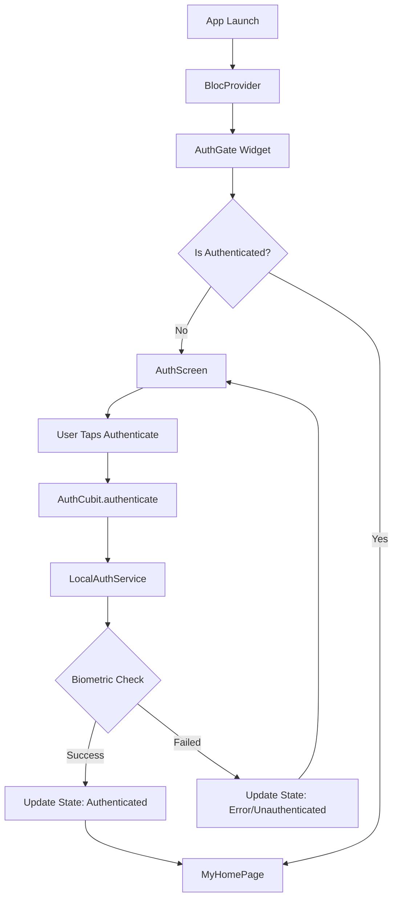
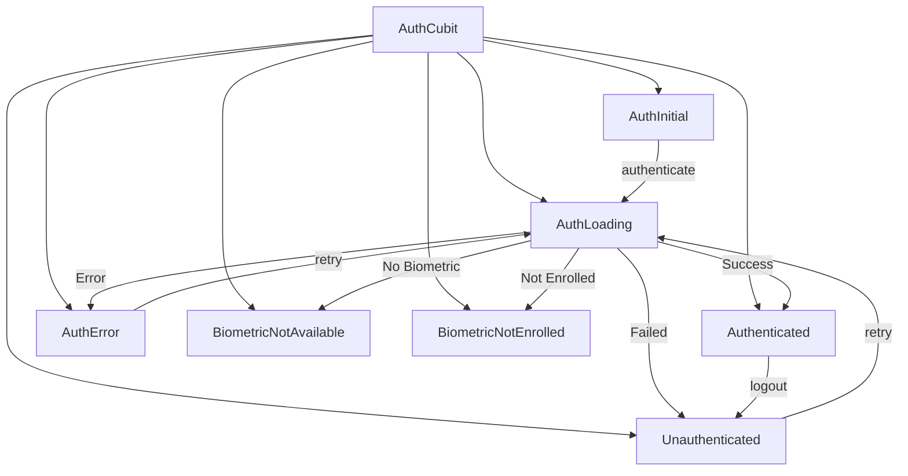
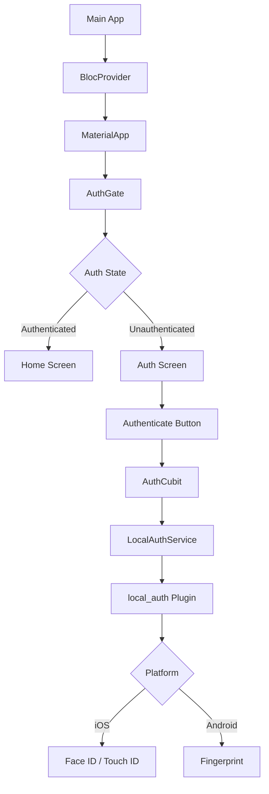

# Flutter Biometric Authentication App

A Flutter application with comprehensive local biometric authentication featuring Face ID, Touch ID, and fingerprint support with device credential fallback.

## 📱 Features

- 🔐 **Biometric Authentication** - Support for Face ID (iOS), Touch ID (iOS), and Fingerprint (Android)
- 🔑 **Device Credential Fallback** - PIN/Pattern/Password as backup authentication
- 🎨 **Modern UI** - Clean, gradient-based authentication screen
- 🏗️ **State Management** - Flutter Bloc (Cubit) for efficient state management
- ✅ **Comprehensive Error Handling** - User-friendly error messages for all scenarios
- 🛡️ **Authentication Gate** - Protect any screen with wrapper widget
- 🔄 **App Lifecycle Authentication** - Automatic re-authentication when app resumes from background
- 📱 **Cross-Platform** - Works on both iOS and Android

## 🏛️ Architecture

### Authentication Flow



### State Management



### Component Structure



## 🚀 Getting Started

### Prerequisites

- Flutter SDK (^3.9.0)
- Dart SDK (^3.9.0)
- iOS device with Face ID/Touch ID or Android device with fingerprint sensor
- Xcode (for iOS development)
- Android Studio (for Android development)

### Installation

1. **Clone the repository:**
   ```bash
   git clone <repository-url>
   cd for_learning
   ```

2. **Install dependencies:**
   ```bash
   flutter pub get
   ```

3. **Run the app:**
   ```bash
   flutter run
   ```

## 📦 Dependencies

```yaml
dependencies:
  flutter:
    sdk: flutter
  local_auth: ^3.0.0        # Biometric authentication
  flutter_bloc: ^8.1.6      # State management
  equatable: ^2.0.5         # State equality comparison
  cupertino_icons: ^1.0.8   # iOS icons
  flutter_flavor: ^3.1.4    # Flavor configuration
```

## ⚙️ Platform Configuration

### iOS Setup

1. **Add Face ID permission to `ios/Runner/Info.plist`:**
   ```xml
   <key>NSFaceIDUsageDescription</key>
   <string>We use Face ID to securely authenticate you and protect your data</string>
   ```

2. **Minimum iOS version:** iOS 10.0+

### Android Setup

1. **Add permission to `android/app/src/main/AndroidManifest.xml`:**
   ```xml
   <uses-permission android:name="android.permission.USE_BIOMETRIC"/>
   ```

2. **Minimum Android SDK:** API 23 (Android 6.0)

## 💻 Usage

### Basic Authentication

The app automatically shows the authentication screen on launch:

```dart
void main() {
  runApp(const MyApp());
}

class MyApp extends StatelessWidget {
  @override
  Widget build(BuildContext context) {
    return BlocProvider(
      create: (context) => AuthCubit(),
      child: MaterialApp(
        home: AuthGate(
          child: MyHomePage(title: 'Home'),
        ),
      ),
    );
  }
}
```

### Protecting Specific Screens

Wrap any screen with `AuthGate` to require authentication:

```dart
Navigator.push(
  context,
  MaterialPageRoute(
    builder: (context) => AuthGate(
      child: SettingsScreen(),
    ),
  ),
);
```

### Manual Authentication

Trigger authentication programmatically:

```dart
// Standard authentication (biometric + device credentials)
context.read<AuthCubit>().authenticate();

// Custom reason message
context.read<AuthCubit>().authenticate(
  reason: 'Authenticate to view sensitive data',
);

// Biometric only (no PIN fallback)
context.read<AuthCubit>().authenticate(
  reason: 'Use biometric to continue',
  biometricOnly: true,
);
```

### Logout

```dart
// Add logout button
IconButton(
  icon: const Icon(Icons.logout),
  onPressed: () {
    context.read<AuthCubit>().logout();
  },
)
```

### Check Authentication Status

```dart
BlocBuilder<AuthCubit, AuthState>(
  builder: (context, state) {
    if (state is Authenticated) {
      return Text('Welcome! Authenticated at ${state.authenticatedAt}');
    } else if (state is AuthLoading) {
      return CircularProgressIndicator();
    }
    return Text('Please authenticate');
  },
)
```

## ⏱️ App Lifecycle Authentication

The app automatically locks and requires re-authentication when it resumes from the background. This is configured through the `AuthCubit`.

### Default Behavior (Always Lock)

By default, the app locks immediately when you switch away and return:

```dart
// In main.dart, the default behavior is already active
BlocProvider(
  create: (context) => AuthCubit(), // Default: lockTimeout = 0 seconds
  child: MaterialApp(...),
)
```

**How it works:**
1. User authenticates and accesses the app
2. User switches to another app (press home or recent apps)
3. User returns to the app
4. **Lock screen appears** requiring re-authentication
5. User re-authenticates to continue

### Configure Lock Timeout

You can configure a time threshold - the app only locks if it's been in the background longer than the specified duration:

```dart
// Lock only if app was in background for more than 30 seconds
BlocProvider(
  create: (context) {
    final authCubit = AuthCubit();
    authCubit.lockTimeout = const Duration(seconds: 30);
    return authCubit;
  },
  child: MaterialApp(...),
)
```

**Examples:**

```dart
// Lock after 1 minute in background
authCubit.lockTimeout = const Duration(minutes: 1);

// Lock after 5 minutes in background
authCubit.lockTimeout = const Duration(minutes: 5);

// Always lock on resume (default)
authCubit.lockTimeout = const Duration(seconds: 0);

// Never lock on resume (disable lifecycle auth)
authCubit.lockTimeout = const Duration(days: 365); // Effectively disabled
```

### Manually Lock the App

You can manually trigger the app lock:

```dart
// Lock the app programmatically
context.read<AuthCubit>().lockApp();

// Example: Lock after 3 failed attempts
int failedAttempts = 0;
if (authFailed) {
  failedAttempts++;
  if (failedAttempts >= 3) {
    context.read<AuthCubit>().lockApp();
  }
}
```

## 📂 Project Structure

```
lib/
├── blocs/
│   ├── auth_cubit.dart          # Authentication state management
│   └── auth_state.dart          # Authentication states
├── screens/
│   └── auth_screen.dart         # Authentication UI screen
├── widgets/
│   ├── auth_gate.dart           # Authentication wrapper widget
│   └── lifecycle_manager.dart   # App lifecycle observer
├── local_auth_service.dart      # Biometric authentication service
└── main.dart                    # App entry point

ios/
└── Runner/
    └── Info.plist               # iOS permissions configuration

android/
└── app/
    └── src/
        └── main/
            └── AndroidManifest.xml  # Android permissions

plans/
├── implementation_plan.md       # Implementation details
├── task.md                      # Task checklist
└── walkthrough.md              # Feature walkthrough
```

## 🧪 Testing

### Manual Testing on Android

1. **Enable fingerprint on emulator:**
   - Open emulator settings (⋮)
   - Navigate to **Fingerprint**
   - Touch the sensor to simulate fingerprint

2. **Test scenarios:**
   - ✅ Launch app → authentication screen appears
   - ✅ Tap "Authenticate" → biometric prompt shows
   - ✅ Authenticate successfully → home page appears
   - ✅ Tap logout → returns to auth screen
   - ✅ Cancel authentication → shows error, allows retry
   - ✅ Use device PIN fallback → PIN entry appears

### Manual Testing on iOS

1. **Setup Face ID/Touch ID:**
   - Settings → Face ID & Passcode (or Touch ID)
   - Enroll biometric authentication

2. **Test scenarios:**
   - ✅ Launch app → authentication prompt appears
   - ✅ Use Face ID/Touch ID → authenticates successfully
   - ✅ Cancel → shows authentication screen
   - ✅ Failed authentication → retry option available

### Simulator Testing (iOS)

For iOS Simulator, you can simulate biometric authentication:
- **Features** → **Face ID** → **Enrolled**
- **Features** → **Face ID** → **Matching Face** (when prompted)

## 🎯 Authentication States

| State | Description |
|-------|-------------|
| `AuthInitial` | Initial state when app loads |
| `AuthLoading` | Authentication in progress |
| `Authenticated` | User successfully authenticated |
| `Unauthenticated` | User not authenticated or cancelled |
| `AuthError` | General authentication error |
| `BiometricNotAvailable` | Device doesn't support biometrics |
| `BiometricNotEnrolled` | No biometrics enrolled on device |

## 🔧 Troubleshooting

### "Biometric not available" on emulator

**Solution:**
- Enable fingerprint simulation in emulator settings
- Ensure emulator has screen lock configured (PIN/pattern)

### App doesn't request authentication

**Solution:**
- Verify `AuthGate` is wrapping the protected content
- Check `BlocProvider<AuthCubit>` is at app root
- Restart the app completely

### "Face ID permission denied" on iOS

**Solution:**
- Verify `NSFaceIDUsageDescription` exists in `Info.plist`
- Check iOS Settings → Privacy & Security → Face ID
- Reinstall the app if permission was previously denied

### Authentication fails immediately

**Solution:**
- Check device has biometrics enrolled
- Verify platform permissions are configured
- Check error messages in `AuthError` state

## 🔮 Future Enhancements

- [ ] Session management with auto-lock
- [ ] Persistent authentication state
- [ ] Session timeout configuration
- [ ] Multi-factor authentication
- [ ] Biometric type detection display
- [ ] Unit tests for `AuthCubit`
- [ ] Widget tests for `AuthScreen`
- [ ] Integration tests for complete flow

## 📄 License

This project is licensed under the MIT License.

## 🤝 Contributing

Contributions are welcome! Please feel free to submit a Pull Request.

## 📞 Support

For issues and questions:
- Create an issue in the repository
- Check the [walkthrough documentation](plans/walkthrough.md)
- Review the [implementation plan](plans/implementation_plan.md)

---

**Built with ❤️ using Flutter and Flutter Bloc**
