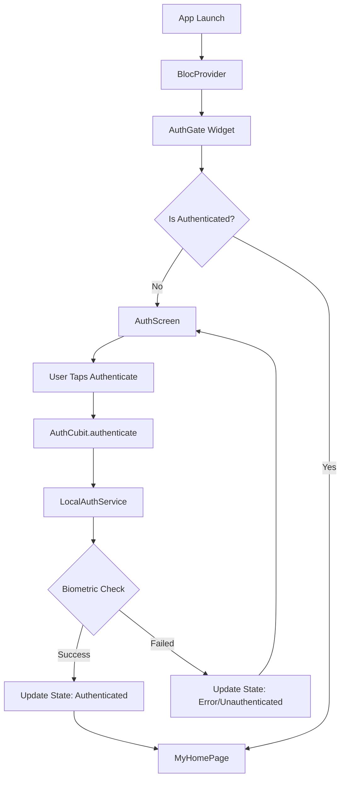

# Local Authentication Feature - Implementation Walkthrough

This walkthrough documents the complete implementation of the local authentication feature for your Flutter app using biometric authentication with Flutter Bloc state management.

## Implementation Summary

Successfully implemented a comprehensive local authentication system with:
- ✅ Enhanced authentication service with biometric support
- ✅ Flutter Bloc (Cubit) state management
- ✅ Modern authentication UI screen
- ✅ Authentication gate for protecting content
- ✅ Platform-specific configurations (Android & iOS)
- ✅ Comprehensive error handling

---

## Architecture Overview



---

## Files Created & Modified

### Core Service Layer

#### [local_auth_service.dart](file:///e:/mdsoft-projects/for_learning/lib/local_auth_service.dart)

Enhanced authentication service with:
- **Biometric availability checking** - `isDeviceSupported()`, `canCheckBiometrics()`
- **Multiple authentication methods** - `authenticate()`, `authenticateWithBiometrics()`
- **Comprehensive error handling** - Custom `AuthException` and `AuthResult` enum
- **User-friendly error messages** - `getResultMessage()`

Key methods:
```dart
// Check device support
await LocalAuthService.isDeviceSupported()

// Authenticate with biometrics (fingerprint, Face ID, etc.)
final result = await LocalAuthService.authenticate(
  localizedReason: 'Please authenticate to continue',
  biometricOnly: false, // Allow device PIN fallback
)
```

---

### State Management

#### [lib/blocs/auth_state.dart](file:///e:/mdsoft-projects/for_learning/lib/blocs/auth_state.dart)

Authentication state classes using Equatable:
- `AuthInitial` - Initial state
- `AuthLoading` - Authentication in progress
- `Authenticated` - User authenticated successfully
- `Unauthenticated` - User not authenticated
- `AuthError` - Authentication error occurred
- `BiometricNotAvailable` - Device doesn't support biometrics
- `BiometricNotEnrolled` - No biometrics enrolled on device

#### [lib/blocs/auth_cubit.dart](file:///e:/mdsoft-projects/for_learning/lib/blocs/auth_cubit.dart)

Authentication Cubit for state management:
- `authenticate()` - Trigger authentication
- `logout()` - Log out user
- `checkDeviceCapabilities()` - Check if device supports biometrics
- `retry()` - Retry failed authentication

---

### UI Components

#### [lib/screens/auth_screen.dart](file:///e:/mdsoft-projects/for_learning/lib/screens/auth_screen.dart)

Modern authentication screen featuring:
- **Gradient background** for visual appeal
- **State-based UI** - Different displays for loading, error, success
- **Error messaging** - User-friendly error displays with appropriate colors
- **Fallback option** - Device PIN/Pattern button when biometrics fail
- **BlocConsumer** - Listens to auth state changes and rebuilds UI

Key features:
- Automatic snackbar notifications for device issues
- Retry button for recoverable errors
- Dynamic button text and icons based on state
- Responsive to all authentication states

#### [lib/widgets/auth_gate.dart](file:///e:/mdsoft-projects/for_learning/lib/widgets/auth_gate.dart)

Authentication gate widget that:
- Wraps protected content
- Shows `AuthScreen` when unauthenticated
- Shows protected content when authenticated
- Checks device capabilities on initialization

Usage:
```dart
AuthGate(
  child: MyHomePage(title: 'Protected Page'),
)
```

---

### Integration

#### [lib/main.dart](file:///e:/mdsoft-projects/for_learning/lib/main.dart)

Updated to integrate authentication:
- Added `BlocProvider<AuthCubit>` at app root
- Wrapped home page with `AuthGate`
- Imports for `flutter_bloc`, `AuthCubit`, and `AuthGate`

---

### Platform Configuration

#### Android - [AndroidManifest.xml](file:///e:/mdsoft-projects/for_learning/android/app/src/main/AndroidManifest.xml)

Already configured with:
```xml
<uses-permission android:name="android.permission.USE_BIOMETRIC"/>
```

#### iOS - [Info.plist](file:///e:/mdsoft-projects/for_learning/ios/Runner/Info.plist)

Added Face ID permission:
```xml
<key>NSFaceIDUsageDescription</key>
<string>We use Face ID to securely authenticate you and protect your data</string>
```

---

### Dependencies

#### [pubspec.yaml](file:///e:/mdsoft-projects/for_learning/pubspec.yaml)

Added dependencies:
```yaml
dependencies:
  local_auth: ^3.0.0  # Already present
  flutter_bloc: ^8.1.6  # State management
  equatable: ^2.0.5  # State comparison
```

---

## How It Works

### 1. App Launch Flow

1. User opens app
2. `BlocProvider` creates `AuthCubit` instance
3. `AuthGate` checks authentication state
4. Since initially unauthenticated, `AuthScreen` is shown
5. `AuthScreen` calls `checkDeviceCapabilities()` on init

### 2. Authentication Flow

1. User taps "Authenticate" button
2. `AuthCubit.authenticate()` is called
3. `LocalAuthService.authenticate()` triggers system biometric prompt
4. User authenticates with fingerprint/Face ID
5. On success, `AuthCubit` emits `Authenticated` state
6. `AuthGate` detects state change and shows protected content
7. User sees `MyHomePage`

### 3. Error Handling

**Device Not Supported:**
- Shows orange warning with fallback to PIN option

**No Biometrics Enrolled:**
- Shows blue info message
- Provides device credentials button

**Authentication Failed:**
- Shows red error message
- Provides retry button

**User Cancelled:**
- Shows unauthenticated state
- User can retry

---

## Testing Instructions

### Manual Testing

> [!IMPORTANT]
> Biometric authentication requires a physical device or properly configured emulator.

#### On Android Device:

1. **Run the app:**
   ```bash
   flutter run
   ```

2. **Test scenarios:**
   - ✓ Tap "Authenticate" - biometric prompt should appear
   - ✓ Authenticate with fingerprint - should show home page
   - ✓ Restart app - should require authentication again
   - ✓ Cancel authentication - should show error and allow retry
   - ✓ Tap "Use Device PIN/Pattern" - should show PIN entry

#### On Android Emulator:

1. **Enable biometric simulation:**
   - Open emulator settings (three dots)
   - Go to "Fingerprint" settings
   - Touch the sensor in the emulator

2. **Test as above**

#### On iOS Device:

1. **Ensure Face ID or Touch ID is enrolled**
2. **Run the app:**
   ```bash
   flutter run
   ```
3. **Test Face ID/Touch ID authentication**

---

## Usage Examples

### Protecting Specific Screens

Wrap any screen with `AuthGate`:

```dart
// Protect a specific route
Navigator.push(
  context,
  MaterialPageRoute(
    builder: (context) => AuthGate(
      child: SettingsScreen(),
    ),
  ),
);
```

---

## Logout Feature

The app includes a logout button in the AppBar that allows users to log out and return to the authentication screen.

**Location:** Home page AppBar (top-right corner)

**How it works:**
- Click the logout icon (🔓) in the AppBar
- `AuthCubit.logout()` is called
- App state changes to `Unauthenticated`
- `AuthGate` detects the state change
- User is redirected to `AuthScreen`

---

## Usage Examples

### Manual Logout

The logout button is already included in the home page AppBar:

```dart
IconButton(
  icon: const Icon(Icons.logout),
  tooltip: 'Logout',
  onPressed: () {
    context.read<AuthCubit>().logout();
  },
)
```

You can add similar logout buttons to any screen:

```dart
ElevatedButton(
  onPressed: () {
    context.read<AuthCubit>().logout();
  },
  child: Text('Logout'),
)
```

### Custom Authentication Reason

```dart
context.read<AuthCubit>().authenticate(
  reason: 'Authenticate to view sensitive data',
  biometricOnly: true, // Force biometric only
)
```

### Check Authentication Status

```dart
BlocBuilder<AuthCubit, AuthState>(
  builder: (context, state) {
    if (state is Authenticated) {
      return Text('Welcome! Authenticated at ${state.authenticatedAt}');
    }
    return Text('Please log in');
  },
)
```

---

## Next Steps

### Recommended Enhancements

1. **Session Management**
   - Add auto-lock after inactivity
   - Persist authentication state
   - Add session timeout

2. **Advanced Features**
   - Multi-factor authentication
   - Biometric type detection display
   - App lifecycle authentication (re-auth when app resumes)

3. **Testing**
   - Add unit tests for `AuthCubit`
   - Add widget tests for `AuthScreen`
   - Add integration tests for full flow

---

## Troubleshooting

### Common Issues

**Issue: "Biometric not available" on emulator**
- ✓ Enable fingerprint simulation in emulator settings
- ✓ Ensure emulator has security set up (PIN/pattern)

**Issue: App doesn't request authentication**
- ✓ Verify `AuthGate` is wrapping the home page
- ✓ Check `BlocProvider` is at app root
- ✓ Restart the app

**Issue: "Face ID permission denied" on iOS**
- ✓ Verify `NSFaceIDUsageDescription` in Info.plist
- ✓ Check iOS settings > Privacy > Face ID

---

## Summary

You now have a fully functional local authentication feature with:
- ✅ Biometric authentication (fingerprint, Face ID, Touch ID)
- ✅ Device credentials fallback (PIN/pattern/password)
- ✅ Modern, user-friendly UI
- ✅ Comprehensive error handling
- ✅ Flutter Bloc state management
- ✅ Platform configurations for Android & iOS
- ✅ **Logout button** in the AppBar

The feature is ready for testing on physical devices or emulators!
